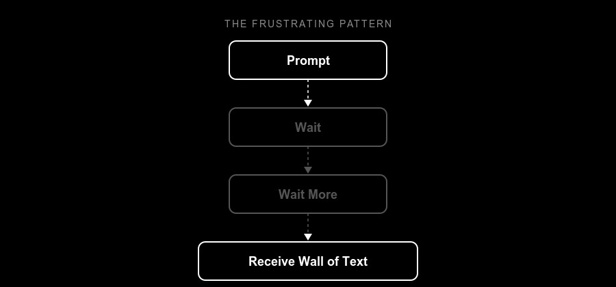
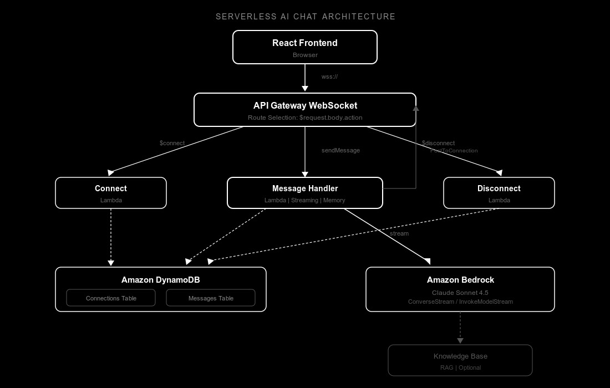
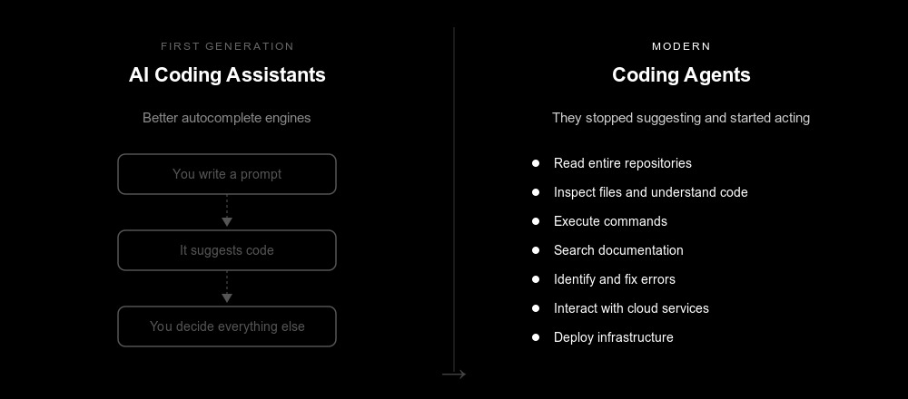
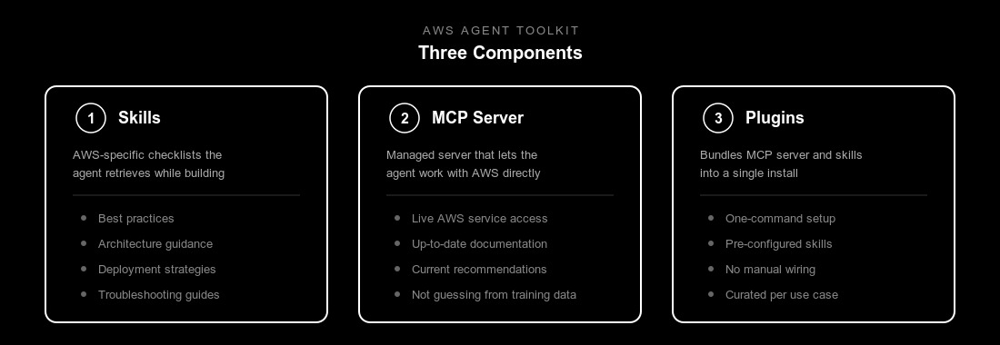
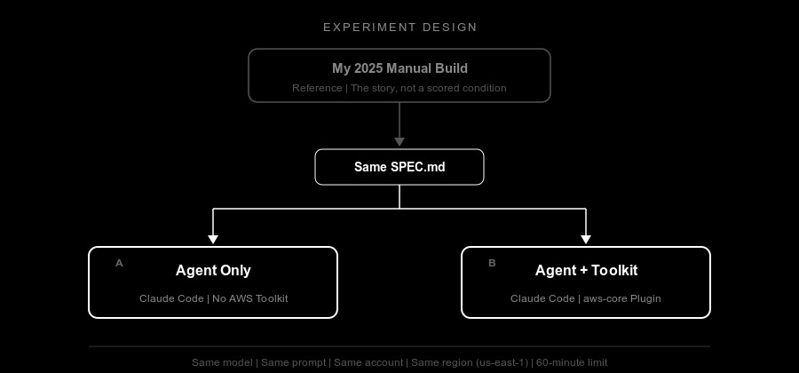
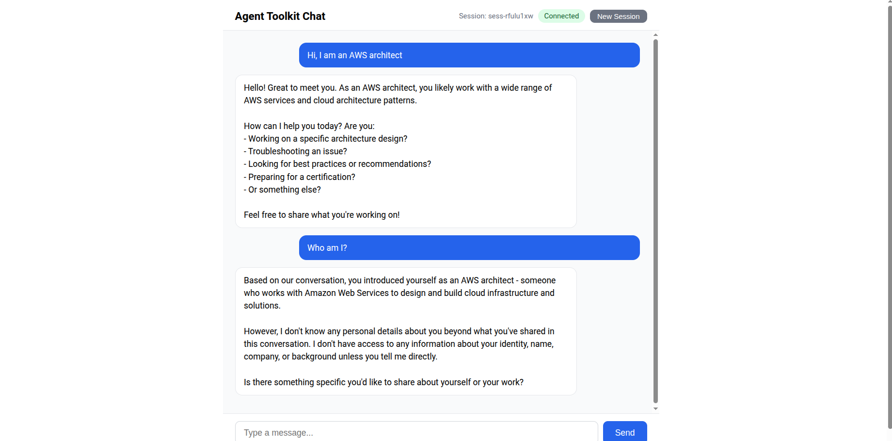
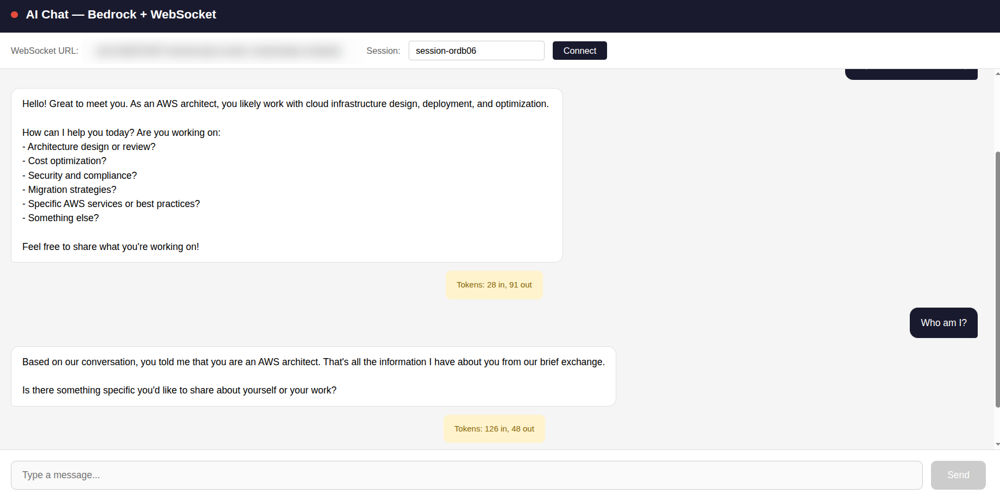
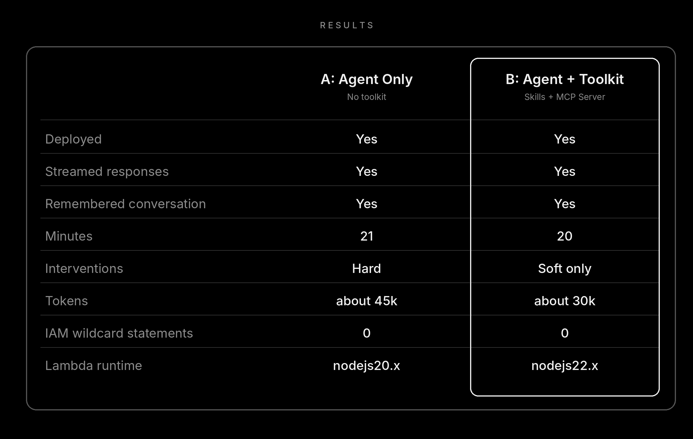

Last year, I built a serverless AI chat application on AWS by hand. This year, I gave the same kind of spec to a coding agent. Twice.

Once on its own, and once with the Agent Toolkit for AWS installed. Same agent, same model, same prompt, same AWS account. The only thing I changed was the toolkit.

I wanted to answer one question:

**Can AWS-specific tooling make a coding agent a better AWS engineer?**

Here is what I built, how I tested it, and what actually changed (and what didn’t).

## 2025: Building My AI Chat Application

In 2025, I built a serverless AI chat application on AWS ([I wrote about that build here](https://awan.com.np/build-ai-chat-aws-bedrock-serverless/)).

At the time, I thought I was building a chatbot.

I wasn’t. I was building a distributed system.

The idea looked simple enough on paper.

A user sends a message. An AI model generates a response. The application displays the result.


But it introduced a different set of engineering challenges.

There were three requirements that shaped the architecture.

### 1. Real-Time Streaming

Most AI applications follow a frustrating pattern.



The model might be generating tokens immediately, but the user sees nothing until the response is ready.

I wanted users to see the response as it was being generated.

### 2. Access to External Knowledge

A regular chat application responds to what the model already knows.

I wanted mine to do more.

A planner could decide whether a tool was needed, trigger a Knowledge Base lookup, and pass the retrieved information to the model before generating the final response.

This introduced another layer to the application.

### 3. Fully Serverless

I didn't want infrastructure sitting idle.

If nobody used the application for a week, it would cost essentially nothing.

Eventually, the architecture settled into something like this:



## Modern Agents Feel Different

Agentic coding tools are changing the way we develop software.

Traditionally, almost everything revolved around the engineer.

We made the decisions, wrote the code, connected the services, ran the application, and fixed the errors.

AI was there to assist us.

The first generation of AI coding assistants didn't fundamentally change how we worked.

They were better auto-complete engines.

Write a Lambda function.

They wrote a Lambda function.

But modern coding agents are different.

They can:

- Read entire repositories.
- Inspect files and understand existing code.
- Execute commands.
- Search documentation.
- Identify errors and attempt to fix them.
- Interact with cloud services.
- Even deploy infrastructure.

The difference is quite significant.



They stopped suggesting and started acting. And once an agent can act inside your AWS account, two questions matter: does it know AWS well enough to do it right, and what stops it from doing something it shouldn't?

## What Is the Agent Toolkit for AWS?

Before looking at the toolkit itself, it’s worth understanding why something like it needs to exist.

AWS contains hundreds of services, overlapping architectural patterns, and complex IAM relationships. Expecting either developers or coding agents to remember every service, best practice, and deployment nuance is unrealistic.

Most of the time, that’s fine. It stops being fine when you hit:

1. Deployment errors
2. Debugging challenges
3. Troubleshooting complex service interactions

Modern agents can already write the code. What they struggle with is navigating the huge AWS ecosystem: picking the right API, the right permissions, and the right fix when something breaks. That’s exactly the gap the toolkit claims to fill.

### What the Toolkit Claims to Do

The pitch is simple: help coding agents build on AWS effectively, with fewer errors and stronger security controls. AWS launched it in May 2026 as the successor to the MCP servers, plugins and skills that used to live in AWS Labs ([product page](https://aws.amazon.com/products/developer-tools/agent-toolkit-for-aws/)).

It has three parts:



**1. Skills**

AWS-specific guides the agent can pull in while it works: best practices, architecture guidance, deployment steps and troubleshooting entries.

**2. AWS MCP Server**

A managed server that lets the agent work with AWS services directly and search up-to-date documentation while it builds. Instead of guessing from its training data, the agent can check what AWS currently recommends.

**3. Plugins**

Plugins bundle the MCP server configuration and a curated set of skills into one install, so we don't need to wire it up.

## What I Tested

My study focuses on practical engineering outcomes. I looked at six areas:

1. **Deployment Success:** Can the application be deployed successfully?
2. **Human Intervention:** How often does it need my help?
3. **Architecture Decisions:** Does the generated architecture make sense?
4. **Infrastructure Quality:** Are AWS resources configured correctly?
5. **Security:** Does it follow least-privilege principles?
6. **Cost and Efficiency:** How much effort, time, and compute are required to reach a working solution?

### What I'm Not Testing

- Other agents and models. I use one agent and one pinned model, so results don't generalize.
- General coding ability. This isn't a coding benchmark.
- AWS versus other clouds.
- Other regions. Everything runs in us-east-1.
- The whole toolkit. I only test what affects building this chat app.

## The Experiment

I wanted a fair test, so I changed exactly one thing.



My 2025 build is the story, not a scored condition. A and B are the comparison.

The question: does adding the Agent Toolkit for AWS change how well the same coding agent builds and deploys the same app?

### The Assignment

Both runs got the same SPEC.md: a streaming AI chat backend on AWS, similar to the one I built by hand last year.

- API Gateway WebSocket API
- Lambda backend
- Amazon Bedrock, streamed token by token
- DynamoDB for session memory, so history survives reconnects
- AWS CDK for deployment, with one command to deploy and one to destroy
- Least-privilege IAM

The spec fixes the outside (how clients connect, how messages look, what tools to use). It leaves the inside open, so the agent picks its own architecture.

A run counts as successful if:

- It deploys
- Responses stream over WebSocket
- Conversation history persists
- Everything is defined in CDK

### The Two Conditions

**A, Agent Only:** Claude Code with no Agent Toolkit for AWS installed.



*Run A (no toolkit): the chat streams and remembers what I told it earlier.*

**B, Agent + Toolkit:** The same Claude Code with the `aws-core` plugin installed (skills plus the AWS MCP Server).

Same model, same prompt, same AWS account, same region (us-east-1).

One note: my spec named the Bedrock model ID directly, which turned out to matter later.



*Run B (with toolkit): same behavior, plus token counts for each message.*

### Setup Details

- **Coding agent:** Claude Code, the same version and model for both runs
- **Toolkit:** `aws-core` plugin, version 1.2.0
- **Model inside the app:** Claude Sonnet 4.5 on Amazon Bedrock, through the US cross-region inference profile
- **Region and date:** us-east-1, runs done at the end of October 2026

### Keeping It Fair

The toolkit installs globally, not per project. If I’d installed it first, A would have quietly used B’s skills. So I ran A before installing the plugin, then installed it for B. Each run started in a fresh folder containing only SPEC.md, and the stack was destroyed and checked before the next run.

The cost of this setup: A ran before B, so time of day and model changes weren't balanced.

### The Rules

- Identical prompt for every run
- I only helped when stuck. Typing “continue” or pasting an error counts as a soft intervention; anything that adds new information counts as a hard one. I logged everything in each run’s RESULT.md.
- This is a small field test, not a benchmark, so I show every run.

### How I Scored It

By checking, not by feel:

- Manual WebSocket tests: tokens stream, history survives a reconnect
- Minutes to a working result
- Interventions
- Usage from the agent's report
- IAM wildcard count

One more source of evidence: I asked B to explain what the toolkit contributed (TOOLKIT_USAGE.md). That’s the agent grading itself, so I checked every claim against run A and the transcript. Both files are linked at the end.

## Results

**The outcome was the same. The path was not.**

At first glance, the results looked almost identical. Both runs produced a working application that deployed, streamed responses, and remembered the conversation.

The **time** didn’t separate them either. **A took 21 minutes and B took 20.** A one-minute gap is noise, not a win, so I’m not counting it as one.



Where the runs did differ was effort. B used about 30k tokens against A’s 45k. B needed only soft interventions, while A needed one hard one, where I had to give it information it couldn’t work out from the error messages alone.

The runtime difference has a simple explanation. B’s CDK skill told it to run `cdk synth --strict` before deploying, which surfaced a deprecation warning for nodejs20.x, so B moved to nodejs22.x. A stayed on nodejs20.x.

I expected a clear winner, and I didn’t get one. Even the problems were the same: both runs hit the same Bedrock model error caused by my spec, and both had to fix cross-region IAM permissions.

### The Same Error, Two Different Paths

My spec named the model directly: `anthropic.claude-sonnet-4-5-20250929-v1:0`. Bedrock rejected it with an “on-demand throughput isn’t supported” error. This model has to be called through an inference profile, so the fix is the profile ID: `us.anthropic.claude-sonnet-4-5-20250929-v1:0`.

That fix caused the second problem. The `us.` profile routes requests across us-east-1, us-east-2 and us-west-2, so an IAM policy scoped only to us-east-1 starts failing as soon as a request lands in another region. Both runs had to allow the foundation model ARNs in all three regions, plus the inference profile ARN.

A worked from the error messages. It read what AWS was telling it, made its own API calls, and pieced the answer together.

B had loaded two skills before writing any code: `aws-core:aws-cdk` and `aws-core:amazon-bedrock`. The Bedrock skill had a troubleshooting entry for exactly this error: list the inference profiles and use the profile ID. It also explained that `us.` profiles route across regions, which pointed straight at the IAM fix.

Even then, B mostly made the AWS call itself rather than going through the MCP server. The skills didn't replace the agent's work. They told it which calls to make and what to look for.

The skill also flagged a problem neither run hit in testing. According to B’s notes, it marked a missing `maxTokens` as a critical warning: leave it out and Claude reserves its full output limit against your quota, which the skill calls the #1 cause of unexpected ThrottlingException. B set it to 1024. A happened to set 4096, so it was fine here, but nothing told it why that matters.

**Going in, I expected the toolkit to help the agent write better code. That isn't what happened. The generated code worked in both conditions, and most of the problems weren't coding problems at all. They were deployment problems: permissions, Bedrock configuration, and service setup.**

The toolkit behaved less like a code assistant and more like an AWS specialist sitting next to the agent.

The difference wasn’t intelligence. The difference was context.

## Production Readiness Checklist

At this point, both implementations looked remarkably similar. Both applications deployed successfully, streamed responses, preserved conversation history, and passed most of the tests I had originally defined. If I stopped here, the conclusion would be simple: both approaches work.

But that's not enough. The hardest problems rarely appear during deployment. They appear weeks later, real users connect; conversations grow longer, costs increase, and error logs start filling up. I had already learned many of these lessons the hard way while building a similar application in 2025.

So I decided to run one more test.

Neither a deployment test nor a functionality test.

A production readiness test.

I took the problems I had encountered in my earlier implementation and turned them into another set of engineering checks.

I wanted to look beyond whether the application worked and understand how well it was engineered.

I split the checks into two groups: implementation details (did it make good choices in code and infrastructure?) and operational concerns (would it survive real traffic?).

| Check | A: Agent only | B: Agent + Toolkit | Notes |
|---|---|---|---|
| **Implementation details** | | | |
| Retry on Bedrock failures | Fail | **Pass** | A: SDK defaults only. B: `retryMode: "adaptive"` with `maxAttempts` set. |
| Bedrock API choice | Partial | **Pass** | A: `InvokeModelWithResponseStream` with model-specific parsing. B: `ConverseStream`, model-agnostic events. |
| Sliding window for history | Fail | **Pass** | A: loads the oldest 50 messages (stale context). B: keeps the newest with `slice(-MAX_HISTORY)`. |
| JSON and error handling | Partial | **Pass** | A: generic handler that leaks `err.message`. B: try/catch with a clean 400 response. |
| DynamoDB grants per function | Partial | **Pass** | A: `grantReadWriteData` on all 3 functions. B: write-only for connect/disconnect, read/write only where needed. |
| Bedrock IAM scoped to model ARNs | **Pass** | **Pass** | Both: inference profile plus the 3 regional model ARNs. No `bedrock:*`. |
| Explicit maxTokens | **Pass** | **Pass** | A: 4096. B: 1024. |
| **Operational concerns** | | | |
| Lambda timeout vs API Gateway | Fail | Fail | Both: 120s Lambda timeout against the 29s API Gateway integration limit. |
| GoneException handling | Fail | Fail | Neither stops streaming when the client disconnects mid-response. |
| DynamoDB TTL | Fail | Fail | Old sessions are never cleaned up. |
| WebSocket reconnect | Fail | Fail | Neither frontend reconnects automatically. |
| Authentication | Fail | Fail | Anyone with the URL can connect. My spec did not ask for it either, so this one is on me too. |
| **Total (12 checks)** | 2 pass, 3 partial, 7 fail | 7 pass, 5 fail | B ahead on 5 checks, all implementation details. |

B came out ahead on 5 of the 12 checks, all of them implementation details. On the 5 operational checks, the runs were identical: both failed every one.

IAM wildcards are in the results table above: neither run used a wildcard action. One small detail went A’s way, though. B kept one CDK-generated wildcard resource on its log-retention helper, while A removed it by switching to explicit LogGroup constructs.

## Key Takeaways

- A had one real bug: once a conversation passes 50 messages, the model gets the oldest history instead of the newest. Short tests never show it.
- B used a third fewer tokens and needed only soft interventions. Time was nearly the same.
- B’s edge came from the skills: the inference profile fix, the Converse API, adaptive retries and tighter DynamoDB grants all trace back to them.
- On the operational checks, both runs missed the same things: timeout alignment, GoneException, DynamoDB TTL, reconnect logic and authentication. These are the problems we usually learn by running software under real traffic.
- Limits: one run each, an agent-assisted audit, and checks partly chosen after seeing the code. Some differences may be run-to-run variation.

## Try It Yourself

If you want to repeat this, or just use what B got right in your own project, here is the short version.

### 1. Install the toolkit in Claude Code

```bash
/plugin marketplace add aws/agent-toolkit-for-aws
/plugin install aws-core@agent-toolkit-for-aws
/reload-plugins
```

If you are running a comparison like mine, install it after your baseline run. It installs globally, so every project on your machine picks up the skills. Setup for other agents like Codex and Kiro is in the [official docs](https://docs.aws.amazon.com/agent-toolkit/latest/userguide/plugins.html).

### 2. Use the inference profile, and scope IAM to every region it routes to

```typescript
const profileId = "us.anthropic.claude-sonnet-4-5-20250929-v1:0";
const modelId = "anthropic.claude-sonnet-4-5-20250929-v1:0";

sendMessageFn.addToRolePolicy(new iam.PolicyStatement({
  actions: ["bedrock:InvokeModelWithResponseStream"],
  resources: [
    `arn:aws:bedrock:${this.region}:${this.account}:inference-profile/${profileId}`,
    ...["us-east-1", "us-east-2", "us-west-2"].map(
      (r) => `arn:aws:bedrock:${r}::foundation-model/${modelId}`
    ),
  ],
}));
```

### 3. Stream with ConverseStream, adaptive retries and an explicit maxTokens

```javascript
import { BedrockRuntimeClient, ConverseStreamCommand } from "@aws-sdk/client-bedrock-runtime";

const bedrock = new BedrockRuntimeClient({
  retryMode: "adaptive",
  maxAttempts: 3,
});

const response = await bedrock.send(new ConverseStreamCommand({
  modelId: process.env.MODEL_ID, // the us. inference profile
  messages: history,
  inferenceConfig: { maxTokens: 1024 },
}));

for await (const event of response.stream) {
  const text = event.contentBlockDelta?.delta?.text;
  if (text) await send(connectionId, { type: "chunk", text });
}
```

### 4. Load the newest history, not the oldest

A’s bug is a classic one. A DynamoDB Query returns items in ascending sort-key order, so `Limit: 50` gives you the first 50 messages ever sent. Read newest first, then flip the order back for the model:

```javascript
const { Items } = await ddb.send(new QueryCommand({
  TableName: process.env.MESSAGES_TABLE,
  KeyConditionExpression: "sessionId = :s",
  ExpressionAttributeValues: { ":s": sessionId },
  ScanIndexForward: false, // newest first
  Limit: 50,
}));
const history = Items.reverse(); // oldest to newest again
```

### 5. Give each function only what it needs

```typescript
connectionsTable.grantWriteData(connectFn);
connectionsTable.grantWriteData(disconnectFn);
connectionsTable.grantReadData(sendMessageFn);
conversationsTable.grantReadWriteData(sendMessageFn);
```

### 6. Add what neither run did

Both runs missed these, so add them yourself:

```javascript
// Stop streaming when the client has left
try {
  await apigw.send(new PostToConnectionCommand({ ConnectionId: connectionId, Data: payload }));
} catch (err) {
  if (err.name === "GoneException") clientGone = true; // stop the loop
  else throw err;
}

// CDK: expire old sessions automatically
const conversationsTable = new dynamodb.Table(this, "ConversationsTable", {
  partitionKey: { name: "sessionId", type: dynamodb.AttributeType.STRING },
  sortKey: { name: "timestamp", type: dynamodb.AttributeType.NUMBER },
  timeToLiveAttribute: "expiresAt",
});
```

- Line up the Lambda timeout with the 29-second API Gateway integration limit.
- Add a Lambda authorizer on the `$connect` route.
- Reconnect with backoff in the frontend, and reuse the same session ID.

## Bottom Line

I started with one question: **can a modern coding agent build the same system end-to-end, and does AWS-native tooling change the outcome?**

Both runs built a working app. The outcome wasn’t the difference. The path was. B read its answers from skills, and A worked them out from error messages.

On implementation details, B came out ahead on 5 of my 12 checks. On the problems you only learn by operating a system, they were identical.

The toolkit changed the defaults the agent picked in the areas its skills cover. It didn’t touch what you only learn by running the system. That part is still on us.

What I keep coming back to:

> *Building software is rarely about knowing the answer. It’s about finding the right answer before the mistake becomes a lesson.*

Thanks to Krishnendu Sukumar for his help with this experiment and article.

## References

- [GitHub repository](https://github.com/awanshrestha/agent-toolkit-experiment)
- [COMPARISON_NOTES.md](https://github.com/awanshrestha/agent-toolkit-experiment/blob/main/runs/B1/COMPARISON_NOTES.md)
- [TOOLKIT_USAGE.md](https://github.com/awanshrestha/agent-toolkit-experiment/blob/main/runs/B1/TOOLKIT_USAGE.md)
- [Results - B](https://github.com/awanshrestha/agent-toolkit-experiment/blob/main/runs/B1/RESULT.md)
- [Results - A](https://github.com/awanshrestha/agent-toolkit-experiment/blob/main/runs/A1/RESULT.md)
- [Agent Toolkit for AWS (product page)](https://aws.amazon.com/products/developer-tools/agent-toolkit-for-aws/)
- [Agent Toolkit for AWS plugins (docs)](https://docs.aws.amazon.com/agent-toolkit/latest/userguide/plugins.html)
- [My 2025 build: serverless AI chat on AWS](https://awan.com.np/build-ai-chat-aws-bedrock-serverless/)
